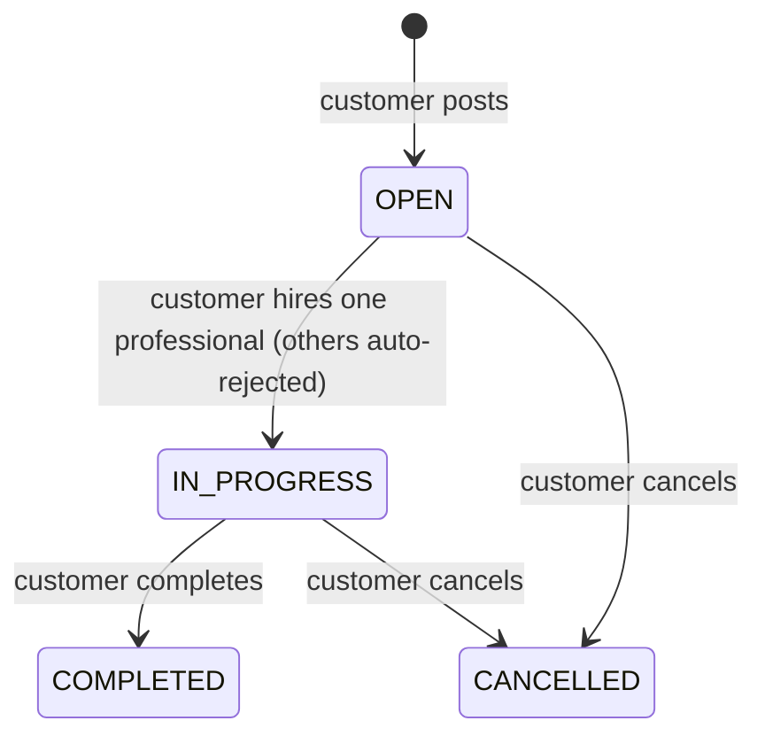
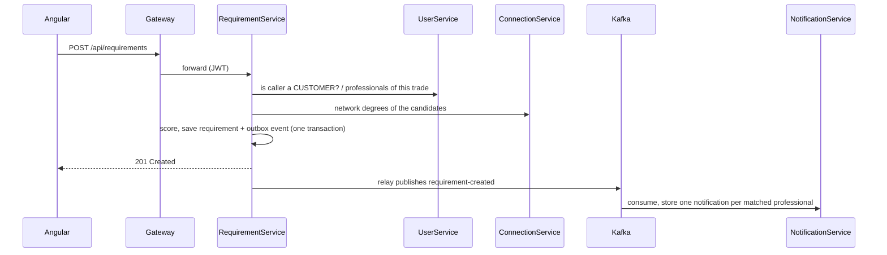
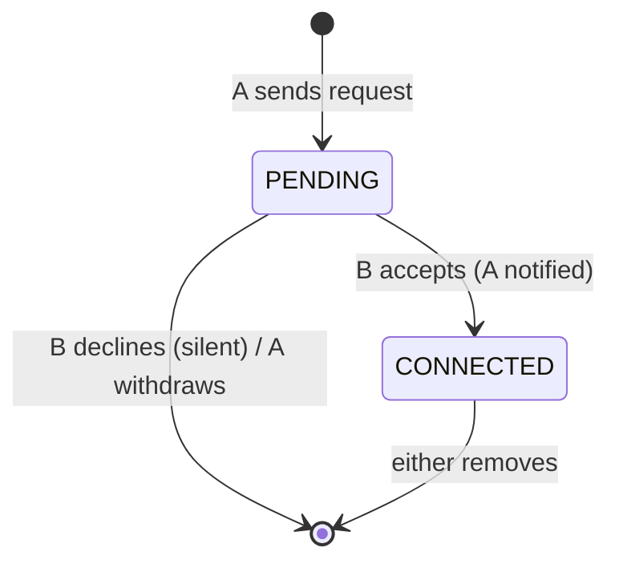

# BuildConnect – Architecture

BuildConnect is a professional network for the construction industry: customers post construction jobs
(requirements), professionals (masons, electricians, roofers, …) find and respond to them, and everyone builds a
network of connections and shares updates. It is built as microservices on .NET 9 with an Angular 22 frontend.

## 1. Services and data ownership

Each service owns its data; no service reads another service's database.

| Service | Responsibility | Data store |
|---|---|---|
| **GatewayService** | Single entry point (`/api/*`), routing (YARP), CORS | – |
| **IdentityService** | Registration, login, JWT access tokens, rotating refresh tokens | PostgreSQL `IdentityDb` |
| **UserService** | Profiles: customer / professional, trade, skills, location, availability | PostgreSQL `linkedin_users` |
| **RequirementService** | Job lifecycle, professionals' interest, hiring, matching and recommendations | PostgreSQL `requirements` |
| **ConnectionService** | Who knows whom: requests, connections, mutual contacts, suggestions, network degree | **Neo4j** |
| **PostService** | Posts, comments, likes, network feed | PostgreSQL `linkedin_posts` |
| **NotificationService** | In-app notifications built from other services' events | SQL Server `linkedin_notifications` |
| BuildingBlocks | Shared library: JWT validation, error handling, Kafka publisher, outbox, tracing, health checks | – |

`ProductService` and `OrderService` are legacy projects kept in the solution; they are not part of the system.

### Why Neo4j for connections
Connection questions follow relationships: "friends of my friends", "connections we share", "is this professional
within two steps of me". In a graph database these are short path patterns that touch only the users involved;
in a relational database they become self-joins or recursive queries over the whole connections table.
`benchmarks/GraphBenchmark` measures this difference (see [EVALUATION.md](EVALUATION.md)).

## 2. Communication

| Style | Used for | Examples |
|---|---|---|
| **Synchronous HTTP** (through the caller's JWT) | Questions that must be answered before replying | RequirementService asks UserService "is this user a customer?"; PostService asks ConnectionService for my connections; ConnectionService asks UserService whether a user exists |
| **Asynchronous events (Kafka)** | Telling others that something happened | Requirement created → matching professionals are notified; connection accepted → requester is notified |

Rules:

- A service never waits for an event consumer; the business action is complete when its own transaction commits.
- Calls to other services degrade gracefully: if ConnectionService is down, matching runs without the network bonus
  and the network feed falls back to all posts; if UserService is down, names fall back to a placeholder.
- NotificationService never calls other services and never decides whether an action was allowed; it only turns
  facts into messages.

## 3. Events

| Business action | Source | Topic / event | Recipient of the notification |
|---|---|---|---|
| Customer posts a job | RequirementService | `requirement-created` / RequirementCreatedEvent | Top 5 matching professionals (score ≥ 70) |
| Professional expresses interest | RequirementService | `professional-interest-submitted` | The customer |
| Customer hires / rejects | RequirementService | `professional-interest-decision` (ACCEPTED / REJECTED) | The professional (one event per affected professional, incl. auto-rejected) |
| Customer cancels a job | RequirementService | `requirement-cancelled` | Professionals still interested or hired |
| Connection requested | ConnectionService | `connection-requested` | The addressee |
| Connection accepted | ConnectionService | `connection-accepted` | The requester |
| Post liked | PostService | `post-liked` | Post author (once per liker, stable event id) |
| Post commented | PostService | `post-commented` | Post author |
| Unprocessable event | NotificationService | `notification-events-dlq` | – (parked for inspection) |

Event contracts live in `BuildingBlocks/Events`; topic names in `EventTopics`.

## 4. Reliability

**Transactional outbox (producers).** A handler stores its business change and the event in the same database
transaction (`OutboxMessages` table in PostgreSQL; `(:OutboxMessage)` nodes in Neo4j). A background relay publishes
pending events to Kafka in order, retrying with exponential backoff (2 s → 60 s) and never skipping a message.
Result: if the change was saved, its event is eventually published – even when Kafka was down at that moment.

**Idempotent consumer.** Delivery is at-least-once, so NotificationService keeps one notification per
`(EventId, recipient)` (unique index). Duplicates are harmless.

**Failure handling in the consumer.** A message that can never succeed (invalid JSON, invalid data) goes to the
dead-letter topic and the partition moves on. A temporary failure (database down) is retried with backoff without
committing the offset, so nothing is lost and order is kept.

**Concurrency.** Hiring uses an optimistic concurrency token (PostgreSQL `xmin`), so two simultaneous decisions on
the same job cannot both succeed. Connection requests lock both user nodes inside one Neo4j transaction, so opposite
requests sent at the same moment cannot both succeed.

## 5. Main workflows

### Job (requirement) lifecycle



Rules (enforced in the `Requirement` entity): only customers post; only professionals of the requested trade respond,
once each, while the job is OPEN; only the owner sees responses and decides; a decision is final; details can be
edited only while OPEN.

Matching score (0–100): 40 same trade + 30 skills + 15 location + 10 availability + 5 experience, plus a **network
trust bonus** of +10 (customer and professional are connected) or +5 (they share a connection), capped at 100.

### Posting a job



### Connections



Graph model: `(:User {id})-[:REQUESTED {status}]->(:User)` and one undirected `(:User)-[:CONNECTED_WITH]-(:User)`.
Only user ids are stored; names come from UserService.

## 6. Security

- JWT access tokens (15 min) signed with a shared HMAC key; every service validates tokens itself. The user id
  always comes from the token, never from the request body.
- Refresh tokens are random, single use, stored only as SHA-256 hashes, and rotated on every refresh; reusing an old
  one revokes all of that user's sessions.
- Ownership checks: only a job's owner decides on it, only the addressee accepts a connection, only a post's author
  edits or deletes it, only the comment author edits a comment (the post author may also delete it), users only see
  their own notifications.
- Secrets are not in source control: .NET user-secrets locally (`scripts/setup-dev-secrets.ps1`), `.env` for
  docker-compose (`scripts/new-docker-env.ps1`). Services refuse to start without a strong JWT key.
- The registration handoff from IdentityService to UserService uses an internal endpoint outside `/api` (not reachable
  through the gateway) protected by a shared service key.

## 7. Observability and operations

- **Tracing:** OpenTelemetry on every service (HTTP in/out and Kafka). The trace context travels through the gateway,
  service-to-service calls, the outbox (stored with the event) and Kafka headers, so one trace in Jaeger shows a
  request from the browser to the notification it caused.
- **Logs:** Serilog, structured, to the console and Seq; each line carries the service name and correlation id.
- **Health:** `GET /health` (liveness) and `GET /health/ready` (database / Neo4j reachable) on every service.
- **Errors:** one middleware maps errors to an `ApiResponse` with the right status (400 validation, 403 forbidden,
  404 not found, 409 conflict, 500 unexpected without internal details).
- **Deployment:** `docker-compose.yml` runs the whole platform; see [RUNNING.md](../RUNNING.md). CI builds, tests and
  builds all service images on every push.

## 8. Code structure

Each service follows the same layering inside one project:

```
Controllers/      HTTP endpoints: read the user from the JWT, send a MediatR command or query
Application/      commands, queries, validators (FluentValidation), handlers, DTOs, ports (interfaces)
Domain/           entities and business rules (e.g. Requirement status transitions, ConnectionRules)
Infrastructure/   EF Core / Neo4j repositories, HTTP clients to other services, Kafka relays and consumers
```

Every command and query has a validator; a MediatR pipeline behaviour runs it before the handler.
